<h1 data-importer="text" align="center">Hello World! 👋 Welcome, I am Kamil Mathea</h1>

###

<h2 data-importer="text" align="center">I am currently completing a targeted training program to become a software developer.  I love efficiency, automation, and smart solutions. Why make things complicated when you can structure them cleverly? Beyond solid web design, I am fascinated by the logic behind the scenes and the interplay of modern technologies.</h2>

###

<h2 data-importer="text" align="center">🛠️ Tech Stack & Skills</h2>

###

  
  
  
  
  
  
  
  
  
  
  
  
  
  
  
  
  
  
  
  
  
  
  

###

  
  

###

<h2 data-importer="text" align="center">🌱 I’m currently learning</h2>

###

  
  
  

###

<h2 data-importer="text" align="center">📬 Connect with Me</h2>

###

  
  

###
